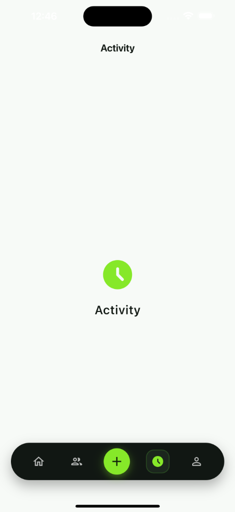

# dark_glassmorphic_bottom_bar

A sleek, modern dark glassmorphic bottom navigation bar for Flutter with frosted glass blur, smooth tab transitions, and optional prominent center action button.

[](https://pub.dev/packages/dark_glassmorphic_bottom_bar)
[](https://opensource.org/licenses/MIT)

---

<p align="center">
  
</p>

---

## ✨ Features

- 🍸 **True Glassmorphism**: Built with `BackdropFilter` and frosted translucent glass overlay.
- ⚡ **Smooth Animations**: Animated selection indicator box with customizable active/inactive icons and duration.
- ➕ **Center Action Button**: Optional prominent floating circular action button (e.g. '+').
- 🎨 **Deeply Customizable**: Configure blur intensity, background tint, borders, shadows, corner radii, and padding via `DarkGlassNavStyle`.
- 📳 **Haptic Feedback**: Built-in subtle selection haptics for a native feel.
- 📱 **Cross-Platform**: Works smoothly on iOS, Android, Web, macOS, Windows, and Linux.

---

## 🚀 Getting Started

Add the dependency to your `pubspec.yaml`:

```yaml
dependencies:
  dark_glassmorphic_bottom_bar: ^0.0.1
```

Or run:

```bash
flutter pub add dark_glassmorphic_bottom_bar
```

Import it in your Dart code:

```dart
import 'package:dark_glassmorphic_bottom_bar/dark_glassmorphic_bottom_bar.dart';
```

---

## 📖 Usage

Ensure your `Scaffold` has `extendBody: true` so the content scrolls behind the frosted glass bar.

```dart
import 'package:flutter/material.dart';
import 'package:dark_glassmorphic_bottom_bar/dark_glassmorphic_bottom_bar.dart';

class HomeScreen extends StatefulWidget {
  const HomeScreen({super.key});

  @override
  State<HomeScreen> createState() => _HomeScreenState();
}

class _HomeScreenState extends State<HomeScreen> {
  int _currentIndex = 0;

  @override
  Widget build(BuildContext context) {
    return Scaffold(
      extendBody: true, // Enables content scrolling behind the glass bar
      backgroundColor: const Color(0xFF0F1511),
      body: Center(
        child: Text('Selected Tab: $_currentIndex'),
      ),
      bottomNavigationBar: DarkGlassmorphicBottomBar(
        selectedIndex: _currentIndex,
        onTabSelected: (index) {
          setState(() {
            _currentIndex = index;
          });
        },
        centerAction: DarkGlassActionItem(
          icon: Icons.add,
          onTap: () {
            // Handle center action tap
          },
        ),
        items: const [
          DarkGlassNavItem(
            icon: Icons.home_outlined,
            activeIcon: Icons.home_rounded,
            label: 'Home',
          ),
          DarkGlassNavItem(
            icon: Icons.people_outline_rounded,
            activeIcon: Icons.people_rounded,
            label: 'Friends',
          ),
          DarkGlassNavItem(
            icon: Icons.access_time_rounded,
            activeIcon: Icons.access_time_filled_rounded,
            label: 'Activity',
          ),
          DarkGlassNavItem(
            icon: Icons.person_outline_rounded,
            activeIcon: Icons.person_rounded,
            label: 'Profile',
          ),
        ],
      ),
    );
  }
}
```

---

## 🛠 Customization (`DarkGlassNavStyle`)

You can customize colors, dimensions, borders, and blur:

```dart
DarkGlassmorphicBottomBar(
  selectedIndex: _currentIndex,
  onTabSelected: (index) => setState(() => _currentIndex = index),
  style: DarkGlassNavStyle(
    blur: 20.0,
    backgroundColor: const Color(0xB8111713), // Translucent dark
    activeColor: const Color(0xFF86E829),       // Neon lime
    inactiveColor: Colors.white70,
    borderRadius: BorderRadius.circular(36.0),
    height: 68.0,
    enableHaptics: true,
  ),
  items: const [
    DarkGlassNavItem(icon: Icons.home_outlined, activeIcon: Icons.home_rounded),
    DarkGlassNavItem(icon: Icons.person_outline_rounded, activeIcon: Icons.person_rounded),
  ],
)
```

### Properties

| Property | Type | Description | Default |
|---|---|---|---|
| `items` | `List<DarkGlassNavItem>` | List of navigation tab items | Required |
| `selectedIndex` | `int` | Currently active tab index | Required |
| `onTabSelected` | `ValueChanged<int>` | Callback fired when tab is tapped | Required |
| `centerAction` | `DarkGlassActionItem?` | Optional center circular action button | `null` |
| `style` | `DarkGlassNavStyle` | Glassmorphic styling configuration | `DarkGlassNavStyle()` |
| `animationDuration` | `Duration` | Tab selection animation speed | `250ms` |
| `animationCurve` | `Curve` | Animation interpolation curve | `Curves.easeInOut` |

---

## 📄 License

This project is licensed under the MIT License - see the [LICENSE](LICENSE) file for details.
